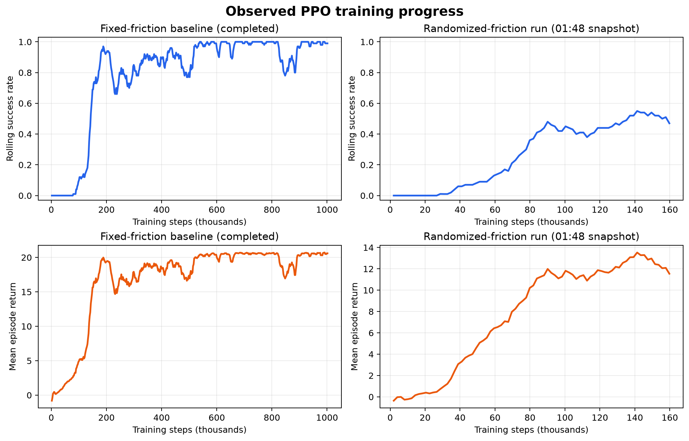

# Contact-Aware Pushing 项目结构与进展审查报告

> 审查快照：2026-09-11 01:48（Asia/Singapore）  
> 审查范围：`/home/deng-xuan/robotics` 工作区、课程源码、运行环境、模型、TensorBoard 日志与视频产物  
> 进度说明：随机摩擦训练在审查期间仍持续写入日志，因此其中的步数是报告生成时的快照，不是最终结果。

## 1. 执行摘要

这是一个基于 **LIBERO + MuJoCo + Gymnasium + Stable-Baselines3 PPO** 的机械臂推盘项目。Panda 机械臂需要把桌上的盘子推入蓝色目标区域；研究方向是在摩擦变化下比较普通状态策略与加入物体速度、接触力后的 contact-aware 策略。

当前已经完成并验证了以下基础闭环：

- 自定义 BDDL 任务可以加载，场景中只有桌、盘子和目标区域；
- Gymnasium 环境、6 维状态、3 维动作、奖励塑形、渲染和环境注册均可工作；
- 三阶段启发式控制器能够完成一次推盘任务；
- 固定摩擦 PPO 已训练约 100 万步，独立复评 10/10 成功；
- 随机摩擦训练基础设施已接通，快照时已生成 50k、100k、150k checkpoint；
- 物体速度与接触力通道已经在环境层实现，9/12 维观测的最小运行验证通过。

但如果以“一份可以形成可靠课程结论的完整研究项目”为 100%，当前更合理的判断是 **约 55%–65%**：工程 MVP 和固定摩擦基线较完整，随机摩擦对照、contact-aware 消融、正式统计评估、复现工程和最终研究结论仍未闭环。

| 模块 | 状态 | 判断 |
|---|---|---|
| 自定义任务与仿真环境 | 已完成 | 可创建、reset、step、render，smoke test 通过 |
| 启发式基线 | 基本完成 | 单一 seed 实测成功，适合作为演示，统计性不足 |
| 固定摩擦 PPO | 已完成基线 | 1,001,472 步模型，当前小样本复评表现稳定 |
| 随机摩擦 PPO | 进行中 | 审查时日志仍增长；快照时已有 150k checkpoint，目标为 500k |
| 速度/接触力观测 | 环境层完成 | 数值与维度验证通过，但训练/评估 CLI 尚未接入 |
| Contact-aware 消融 | 未开始 | 没有 9D/12D 策略模型或对照结果 |
| 正式鲁棒性评估 | 未完成 | 缺少等预算、多 seed、真实摩擦网格和置信区间 |
| 测试与复现工程 | 未完成 | 无项目 Git 历史、依赖锁、pytest 套件、CI 和实验元数据 |

最需要先处理的不是继续堆训练步数，而是一个实验有效性问题：当前代码只改盘子几何体的滑动摩擦。运行时检查发现，盘子参数设为 `0.3` 或 `0.5` 时，盘子—桌面的实际接触摩擦仍为 `0.6`；设为 `0.9` 时才是 `0.9`。也就是说，名义上的 `[0.3, 0.9]` 随机范围实际约被压成 `[0.6, 0.9]`，且低半区集中在 `0.6`。在修正和验证这一点之前，不能把现有结果作为“覆盖 0.3–0.9 摩擦”的正式结论。

## 2. 工作区边界与目录结构

```text
/home/deng-xuan/robotics/
├── contact_aware_pushing/          # 课程项目主体，约 1.5 MB
│   ├── README.md                   # 当前运行说明
│   ├── PROJECT_REPORT_ZH.md        # 本报告
│   ├── tasks/
│   │   └── clean_tabletop_push.bddl
│   ├── envs/
│   │   ├── __init__.py
│   │   ├── custom_libero_env.py
│   │   └── pushing_env.py
│   ├── scripts/
│   │   ├── smoke_test_clean_env.py
│   │   ├── test_pushing_env.py
│   │   ├── heuristic_baseline.py
│   │   ├── train_ppo.py
│   │   └── evaluate_ppo.py
│   ├── inspect_push_task.py        # 早期 LeRobot/LIBERO 探索脚本
│   ├── test_libero.py              # 早期 LeRobot/LIBERO 探索脚本
│   ├── outputs/
│   │   ├── models/
│   │   ├── checkpoints/
│   │   ├── logs/
│   │   └── videos/
│   └── report_assets/
│       └── training_curves.png
├── lerobot/                        # 上游 Hugging Face LeRobot 仓库，约 395 MB
└── datasets/                       # 当前为空
```

这里必须明确两个边界：

1. **`contact_aware_pushing/` 才是课程项目。** 核心主流程直接导入 LIBERO 的 `OffScreenRenderEnv`，并没有把整套 LeRobot 源码当作自己的实现。
2. **`lerobot/` 是独立的第三方上游仓库。** 它当前位于 `main`，与 `origin/main` 同步且工作区干净；主要作用是提供已安装的 LeRobot 代码、LIBERO 相关参考以及早期探索入口，不应计入课程项目代码量或完成度。

`/home/deng-xuan/robotics/.git` 目前是空目录，`contact_aware_pushing/` 也没有独立 Git 仓库。因此课程代码没有可查询的 commit 历史，无法可靠回答“某个模型由哪版代码训练出来”。

## 3. 系统架构与执行流程

```text
clean_tabletop_push.bddl
          │  定义场景、初始状态和成功谓词
          ▼
ProjectLiberoEnv
          │  创建 LIBERO OffScreenRenderEnv，整理图像与 EEF 状态
          ▼
LiberoPushingEnv
          │  低维观测、3D 动作、奖励、终止、摩擦与可选接触特征
          ├──────────────┬────────────────┬─────────────────┐
          ▼              ▼                ▼                 ▼
      smoke test     heuristic        PPO train         PPO evaluate
          │              │                │                 │
          └──────────────┴────────────────┴─────────────────┘
                                 ▼
                  models / checkpoints / logs / videos
```

一次 PPO 交互的主要数据流如下：

1. `reset(seed)` 创建或重置 LIBERO 场景，并执行 10 个 no-op settle steps；
2. 环境读取末端执行器、盘子和目标位置；
3. 默认状态为：

   ```text
   observation = [plate_position - eef_position,
                  goal_position  - plate_position]
   ```

   共 6 维。可再附加 3 维盘子线速度和/或 3 维净接触力，变为 9D 或 12D。

4. PPO 输出 `[-1, 1]^3` 的笛卡尔平移动作；环境乘以 `action_scale=0.5`，补上零旋转与打开夹爪命令，转换成 LIBERO 的 7 维 OSC action；
5. 环境执行一步，重新计算距离、奖励、成功和超时状态；
6. 训练脚本把 rollout 指标写入 TensorBoard，并按间隔保存 checkpoint；评估脚本统计成功率、回报、回合长度和最终目标距离。

## 4. 核心代码讲解

### 4.1 任务定义：`tasks/clean_tabletop_push.bddl`

该文件是场景的语义源头：

- `plate_start_region` 定义盘子的初始位置与小范围随机 yaw；
- `push_target_region` 定义蓝色半透明目标区域；
- `plate_1` 是唯一可动物体；
- 初始条件为盘子位于起始区域；
- 成功条件为 `On(plate_1, main_table_push_target_region)`。

这使任务比 LIBERO 原始多物体场景更干净，适合先研究摩擦、接触和奖励设计。

### 4.2 底层适配：`envs/custom_libero_env.py`

`ProjectLiberoEnv` 是项目与 LIBERO 之间的薄适配层：

- 在首次 reset 时延迟创建 `OffScreenRenderEnv`，机器人为 Panda，控制器为 `OSC_POSE`，频率为 20 Hz；
- reset 后执行若干空动作让物体稳定，并把 controller 切成 delta action；
- 把 LIBERO 原始字典整理成 `pixels.image` 与 `robot_state.eef.{pos, quat}`；
- 将 LIBERO 的四元组 step 返回值转换为 Gymnasium 风格五元组；
- 提供 RGB 渲染和资源关闭。

这一层很小，便于控制场景，但使用了 `_env.env` 等第三方内部结构，升级 LIBERO/robosuite 时需要回归验证。

### 4.3 项目核心环境：`envs/pushing_env.py`

`LiberoPushingEnv` 承担项目最重要的研究逻辑。

**观测：**

- 基础 6D：盘子相对 EEF 的 3D 位移 + 目标相对盘子的 3D 位移；
- `include_object_velocity=True`：追加盘子 3D 线速度；
- `include_contact_force=True`：遍历 MuJoCo contacts，将涉及盘子的接触力转换到世界坐标后求和并追加；
- 摩擦系数故意不放入状态，因此随机摩擦任务属于部分可观测问题，策略需要从运动或接触反馈间接识别动力学。

**动作：**

- 策略只控制 EEF 的 XYZ 平移；
- 姿态增量固定为零；
- 夹爪固定打开；
- 这是一个刻意简化的 pushing action space，降低了 PPO 搜索难度。

**奖励：**

```text
reward = 5  × reach_progress
       + 50 × goal_progress
       - 0.001 × ||action||²
       - 0.0005
       + 10 × success
```

其中 `reach_progress` 鼓励 EEF 接近盘子，`goal_progress` 鼓励盘子靠近目标，动作平方项抑制过大控制量，常数项鼓励更快完成。LIBERO 的 sparse reward 只被记录在 `info` 中，并未直接加入训练奖励。

**结束规则：**

- `terminated=True`：LIBERO 成功、XY 距离进入 `success_radius=0.06`，或底层环境结束；
- `truncated=True`：达到默认 300 步上限。

当前同时使用 LIBERO 的 `On` 谓词与距离阈值，所以会出现“`is_success=True` 但 `goal_distance` 稍大于 0.06”的情况。代码行为本身可解释，但正式论文/报告需要统一成功口径。

**摩擦随机化：**

reset 时从 `friction_range` 均匀采样，并修改盘子所有 geom 的 `geom_friction[:, 0]`。这里的实现尚不等于修改了真实接触对的最终摩擦：桌面一侧的参数仍参与 MuJoCo 接触组合。现场检查结果为：

| 代码请求的盘子滑动摩擦 | 实际盘子—桌面 contact friction |
|---:|---:|
| 0.3 | 0.6 |
| 0.5 | 0.6 |
| 0.6 | 0.6 |
| 0.9 | 0.9 |

因此 `info["friction"]` 当前记录的是盘子一侧的请求值，不一定是真实接触摩擦。这是下一阶段的 P0 问题。

### 4.4 环境注册：`envs/__init__.py`

导入 `envs` 时会把环境注册为 `ContactAwarePushing-LIBERO-v0`。本次通过 `gym.make(...)` 实测可以创建环境，得到 `(6,)` 观测空间和 `(3,)` 动作空间。

### 4.5 启发式基线：`scripts/heuristic_baseline.py`

该脚本用比例控制器完成三阶段闭环：

1. 移到盘子后方的安全悬停点；
2. 降到经验推动高度；
3. 每一步重新计算盘子到目标的方向，并把 EEF 目标放在盘子前方少量距离，持续保持接触推动。

本次在 `/tmp` 重新执行 seed 42：成功，目标距离从约 `0.2565` 降至 `0.0642`，并在 LIBERO `On` 谓词满足时结束。

它目前更适合“行为演示”而不是严谨基线：只有单 seed，阶段参数是经验值，前两阶段未及时处理 terminated/truncated，收敛距离使用的是动作前状态，且没有输出多回合汇总数据。

### 4.6 PPO 训练：`scripts/train_ppo.py`

该脚本负责新训练与续训：

- 支持总步数、seed、checkpoint 间隔、entropy coefficient；
- 支持固定摩擦或每回合均匀随机摩擦；
- 新模型使用 `MlpPolicy`、学习率 `3e-4`、`n_steps=2048`、batch size 64、10 epochs、`gamma=0.99`、`GAE lambda=0.95`；
- 通过 SB3 `Monitor` 记录成功、目标距离与名义摩擦；
- 正常完成时保存最终模型，训练期间按间隔保存 checkpoint。

固定摩擦模型中实际保存的是默认 SB3 MLP：actor 和 critic 各有两层 64 单元 Tanh 网络，输入 6D，actor 输出 3D action。

当前不足是超参数和观测配置写死/分散在代码与命令行中；模型旁没有保存完整 CLI、摩擦范围、依赖版本、代码 commit、评估种子。固定模型内部 `seed=None`，而当前脚本默认值为 42，也说明无法仅凭现有文件完整还原其训练命令。

### 4.7 PPO 评估：`scripts/evaluate_ppo.py`

该脚本可以：

- 加载任意 SB3 PPO zip；
- 运行多个确定性或随机性回合；
- 固定一个名义摩擦值；
- 输出每回合成功、回报、长度、最终距离；
- 录制前若干回合视频。

当前结果只打印到终端，没有保存 CSV/JSON；也没有直接支持摩擦网格、多模型、多 seed、置信区间或 contact-aware observation flags。

### 4.8 验证与探索脚本

- `scripts/smoke_test_clean_env.py`：当前最有效的快速验收，覆盖 SB3 API、6D 状态、渲染、三步数值稳定性、场景对象和名义摩擦；
- `scripts/test_pushing_env.py`：打印随机动作 rollout，主要用于人工观察；
- `inspect_push_task.py` 与 `test_libero.py`：检查 LeRobot 官方 `libero_goal` / `libero_spatial` 任务，是早期探索文件，不在当前本地 BDDL 主执行链上，应在文档中标注为 legacy/exploration。

## 5. 已有实验产物与训练进展

### 5.1 固定摩擦 PPO

`outputs/models/ppo_fixed_friction.zip` 的模型元数据显示：

- `num_timesteps = 1,001,472`；多出的 1,472 步来自 PPO 以 2,048 步 rollout 为单位更新；
- 观测 6D，动作 3D；
- `ent_coef=0.01`，学习率 `3e-4`；
- 训练目标为 1,000,000 步。

与最终模型时间对应的 `PPO_3` TensorBoard 日志末端滚动指标为：

- success rate：`0.99`；
- mean episode return：`20.60`；
- mean episode length：`80.29`；
- explained variance：`0.974` 左右。

`PPO_1`、`PPO_2`、`PPO_3` 分别记录到约 20k、200k、1M 步，可以看出从失败探索到稳定策略的过程，但由于缺少每次运行配置，不能确定它们之间是续训、重启还是不同超参数尝试。

### 5.2 随机摩擦 PPO

审查期间 `outputs/logs/ppo_random_friction_1` 持续增长，并依次新增 100k、150k checkpoint，说明训练仍在进行。报告于 01:48 冻结进度快照时：

- 日志至少达到 `159,744` environment steps，最新完整窗口 success rate 约 `0.47`；
- 已保存 50k、100k 和 150k checkpoint；
- checkpoint 元数据表明训练目标为 500k、seed 42、`ent_coef=0.003`；
- 尚无 `outputs/models/ppo_random_friction.zip` 最终模型；
- 模型文件没有保存环境构造参数，因此仅凭 checkpoint 不能严格证明使用了哪个 `friction_range`。

训练曲线快照如下。右侧曲线在报告生成后仍可能继续增长。



### 5.3 视频

`outputs/videos/` 中已有四段有效 MP4，均为 256×256、20 FPS：

| 文件 | 帧数 | 时长 | 用途 |
|---|---:|---:|---|
| `heuristic_push.mp4` | 243 | 12.15 s | 启发式控制器演示 |
| `ppo_evaluation_smoke.mp4` | 320 | 16.00 s | PPO 早期评估检查 |
| `ppo_deterministic.mp4` | 284 | 14.20 s | 确定性 PPO 演示 |
| `ppo_stochastic.mp4` | 290 | 14.50 s | 随机采样 PPO 演示 |

## 6. 本次现场验证结果

以下结果是本次审查实际执行所得，不只是根据文件名推断：

| 检查 | 结果 |
|---|---|
| 11 个 Python 文件 AST 解析 | 全部通过 |
| `scripts.smoke_test_clean_env` | PASS；6D、64×64×3、名义摩擦采样、场景对象均正常 |
| Gym 注册后 `gym.make` | PASS；obs `(6,)`、action `(3,)` |
| velocity-only / force-only / both | PASS；分别为 9D / 9D / 12D，reset 与单步值有限 |
| 同 seed reset | 初始观测与名义摩擦可重复 |
| 启发式 seed 42 | 成功；目标距离约 0.2565 → 0.0642 |
| 固定模型、默认摩擦、10 episodes | 10/10；mean return 20.640；mean length 75.4；mean final distance 0.0584 |
| 固定模型、请求 μ=0.3、5 episodes | 5/5；mean return 20.476；mean length 73.8；实际 contact μ=0.6 |
| 固定模型、请求 μ=0.9、5 episodes | 5/5；mean return 20.567；mean length 74.6；实际 contact μ=0.9 |
| 随机模型 50k、请求 μ=0.3、5 episodes | 3/5；mean return 15.161；mean length 247.2；实际 contact μ=0.6 |
| 随机模型 50k、请求 μ=0.9、5 episodes | 0/5；mean return 3.360；mean length 300.0；实际 contact μ=0.9 |

解释这些数字时要注意：

- 5 或 10 个 episode 只是功能性抽查，不足以作为课程报告的正式统计；
- 固定模型训练了约 100 万步，而被复评的随机模型只有 5 万步，结果不能用于判断“随机摩擦不如固定摩擦”；
- 请求 `μ=0.3` 实际只测到了接触摩擦 `0.6`；
- 固定模型已经在当前有效范围内出现小样本性能饱和，因此后续实验要先扩大且校准真实动力学变化，否则难以证明 domain randomization/contact sensing 的价值。

环境运行时存在两个非阻塞警告：robosuite 没有 private macro 文件；Matplotlib 配置目录不可写并回退到 `/tmp`。二者没有阻止当前测试通过，但应在复现说明中处理。

## 7. 当前缺口与风险排序

### P0：会影响实验结论的问题

1. **真实接触摩擦与记录值不一致。** 需要明确 MuJoCo 的组合规则，设置正确的盘子—桌面接触参数，并在 reset 后直接验证 active contact friction。
2. **实验不可追溯。** 课程目录无 Git，模型未绑定代码版本、命令、环境配置和 observation variant；现有结果难以严格复现。
3. **成功定义不唯一。** LIBERO `On` 谓词与 `goal_distance <= 0.06` 混用，必须选定主指标并在代码、评估和报告中一致说明。
4. **当前随机训练不是最终科学对照。** 它仍在进行，且使用的物理随机范围存在上述问题；可以保留为开发性结果，但不宜直接写成最终结论。

### P1：完成研究主体所必需

5. **Contact-aware 只完成特征提取。** 训练和评估 CLI 没有 velocity/contact flags，也没有 9D/12D 模型。
6. **比较不公平。** 固定模型约 1M 步，随机模型目标 500k；正式比较需要相同训练预算、相同网络、相同评估种子和至少 3 个训练 seed。
7. **评估没有结构化输出。** 需要 CSV/JSON、摩擦网格、均值/方差或置信区间，以及失败案例标记。
8. **力与速度尺度未处理。** 接触力可能远大于位置量级；在纳入 PPO 前应检查分布、裁剪/归一化，并记录单位。

### P2：工程质量与维护性

9. **无依赖清单或锁文件。** 当前只能依赖已经存在的 `libero-rl` Conda 环境。
10. **没有自动化测试。** 禁用系统第三方 pytest 插件后，项目显示 `no tests collected`；现有“test”是手工脚本。
11. **强依赖当前工作目录。** `from envs...` 与相对 `outputs/` 要求先进入项目目录。
12. **源码与产物混放且无 `.gitignore`。** `__pycache__`、模型、日志、视频以后容易被误提交；大模型应规划 Git LFS、DVC 或外部归档。
13. **使用第三方私有接口。** `_env.env`、`sim.model._model`、`sim.data._data` 等在依赖升级后可能失效。
14. **启发式脚本容错不足。** 前两阶段没有完整处理 episode 结束，资源关闭也未放在 `finally` 中。

## 8. 建议实施计划

下面给出一个约 3 周的稳妥安排；实际墙钟时间主要取决于 GPU 是否可连续使用。现有日志显示 100 万步大约需要 3 个 GPU 小时，可作为粗略预算，但多 seed 和评估还会增加总耗时。

| 阶段 | 建议时长 | 主要工作 | 完成判据 |
|---|---:|---|---|
| M0：保护当前结果 | 立即，1–2 小时 | 让当前 500k 训练正常落盘；保存实际命令、终端输出和最终 checkpoint；不要覆盖已有模型 | 有最终模型、完整日志、可追溯配置副本 |
| M1：修正实验定义 | 0.5–1 天 | 校准盘子—桌面真实接触摩擦；统一成功判定；确定训练内与 OOD 摩擦范围 | 自动检查请求值与 active contact 值一致；指标定义写入 README |
| M2：工程固化 | 0.5–1 天 | 建立课程项目 Git；增加 `.gitignore`、环境锁、配置保存、结果目录规范、pytest smoke tests | 新环境可按文档安装；关键测试一条命令通过 |
| M3：公平基线 | 2–4 天（含计算） | 固定摩擦与随机摩擦采用相同预算、3 个训练 seed；checkpoint 与配置成对保存 | 两组各 3 个有效最终模型，无缺失元数据 |
| M4：Contact-aware 消融 | 3–5 天（含计算） | 训练 6D、6D+velocity、6D+force、12D 四组；先做特征尺度统计与归一化 | 4 variants × 至少 3 seeds，可重复加载评估 |
| M5：正式评估 | 1–2 天 | 在训练内、边界和未见摩擦点各运行不少于 30 个固定 episode seeds；保存 CSV/JSON 和视频 | 有成功率区间、回报、时长、最终距离、动作能耗/接触指标 |
| M6：课程交付 | 1–2 天 | 绘制学习曲线与鲁棒性曲线，整理消融表、失败案例、方法与局限 | 报告、复现说明、模型索引和演示视频齐全 |

建议的正式实验矩阵：

| 维度 | 方案 |
|---|---|
| 观测消融 | 6D；6D+velocity；6D+force；6D+velocity+force |
| 训练动力学 | 固定真实摩擦；校准后的随机摩擦 |
| 训练 seed | 至少 3 个 |
| 评估摩擦 | 训练内多个点 + 两侧 OOD 点；不要只记录盘子 geom 参数 |
| 每点 episode | 至少 30；使用所有模型共享的固定 seeds |
| 主指标 | 成功率及置信区间 |
| 辅助指标 | return、episode length、final distance、动作能耗、接触丢失次数/接触力统计 |

如果时间非常紧，最小可交付路线应是：先修正真实摩擦与成功口径，再完成“固定 6D vs 随机 6D”的等预算三 seed 对照，最后只选 `6D + contact force` 做一个 contact-aware 增量实验。这样仍能回答一个清晰的研究问题；直接在当前物理设置上继续增加模型数量，反而可能得到无法解释的饱和结果。

## 9. 下一步行动清单

按优先顺序建议立即执行：

1. 记录并保护当前正在运行的随机摩擦训练，等待其正常生成 500k 最终模型；
2. 在新开正式实验前修正实际 contact friction，并增加 reset 后的断言/日志；
3. 为每次训练自动保存 `config.json`：命令、seed、观测模式、真实摩擦范围、依赖版本、Git SHA、模型路径；
4. 把环境 smoke、9/12D observation、seed、摩擦、成功/超时边界转成 pytest；
5. 给训练与评估 CLI 增加 observation variant，并对接触力做尺度分析；
6. 运行等预算、多 seed 实验矩阵；
7. 统一导出 CSV/JSON，生成最终曲线、消融表和失败案例视频。

## 10. 总结

这个项目已经跨过了最困难的“从无到有”阶段：自定义任务、仿真适配、低维强化学习环境、启发式策略、PPO 训练与视频评估都已实际跑通，固定摩擦策略也有很好的可运行结果。现在的主要工作不再是搭环境，而是把一个可运行 demo 提升为可信研究：修正真实摩擦、保存完整实验谱系、完成公平的随机化与 contact-aware 消融，并用多 seed 统计支撑结论。

从课程项目角度看，下一阶段只要围绕这一条主线收敛，而不继续扩张场景或算法范围，项目有很清晰的完成路径。
