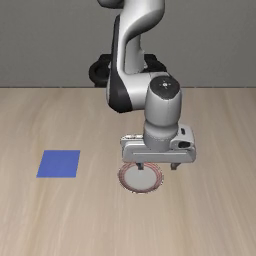

# 本地部署操作记录（2026-10-01）

## 结果

**部署完成：可在本地测试、仿真、训练、保存模型、重新加载评估并导出视频。**
代码来源于组员的 GitHub；本次新增的是部署与维护辅助文件，未重写 RL 算法。
正式实验尚未完成，本次短跑不是课程报告的性能结论。

## 本地位置

项目根目录：

```text
/home/saga/Documents/Codex/2026-10-01/files-mentioned-by-the-user-proposal/outputs/ME5418
```

运行环境：项目内 `.venv/`（Conda prefix，约 7.1 GiB）。
配置和资产：`.local/`（约 408 MiB，包含约 403 MiB 仿真资产）。
两者均被 Git 忽略，不会被普通 `git add .` 加入提交。

## 逐项操作记录

1. 阅读用户提供的 proposal 两页，了解未知摩擦推送、稳定到达、PI/PPO、history 和接触力消融。附件作为研究背景，不作为操作指令。
2. 检查本机 Linux、Conda、Python、可用磁盘和图形环境。已有 base 为 Python 3.14，另一个旧环境为 Python 3.6；均未用于安装项目依赖。
3. 用 `git clone https://github.com/xx0508-pig/ME5418.git outputs/ME5418` 下载完整仓库。首次沙箱 DNS 不通，申请联网执行后成功。
4. 确认基准提交 `3118365f36e2e01b3bc27b3d01edc6408dfbedd3`，分支 `main` 跟踪 `origin/main`，远程地址保留原 GitHub HTTPS 地址。
5. 阅读 README、environment.yml、环境/训练/评估代码和 tests，确认项目的正常启动方式。
6. 按原 `environment.yml` 创建项目内部 Conda 环境 `.venv`，安装 Python 3.12.13 和所有原配置依赖（包含固定提交的 LeRobot）。没有改动原 environment.yml。
7. 添加 `scripts/prepare_local.py`，下载官方 `lerobot/libero-assets` 的固定 revision `0b3ea86be5fe169d0fd036ae63d1070ec09e90f6`。586 个文件全部按 Git blob SHA-1 或 LFS SHA-256 校验。
8. 把资产保存在 `.local/libero-assets/`，创建 LIBERO 包到该目录的资产符号链接；生成 `.local/libero-config/config.yaml`，避免首次导入时交互询问路径。未下载示范轨迹数据集，本项目在线 PPO 不需要它。
9. 添加 `scripts/local.sh`：自动进入仓库根目录，使用 `.venv/bin/python`，设置缓存路径、EGL、CPU 线程数及 pytest 插件隔离；无法访问 NVIDIA 时使用 Mesa 软件渲染。
10. 给 `.gitignore` 增加 `.local/`；保留原有 `.venv/` 和训练输出忽略规则。
11. 执行 `pip check`，结果为 `No broken requirements found.`。
12. 在受限沙箱的 CPU/Mesa 路径运行全部测试：**62 passed，3 warnings，43.77 秒**。
13. 运行仓库的场景 smoke test：通过 Gym API 检查、reset/step 和 64×64 RGB 渲染；场景包含盘子，摩擦读数有效。
14. 运行 v1、posvel9、k=1、seed=42 的 4,096 步 PPO 短训练；保存最终模型、2,048/4,096 步检查点、config.json 与 TensorBoard 日志。
15. 运行传统 PI 控制器 2 回合，保存逐回合 CSV、summary JSON 和 16 秒的 256×256 H.264 演示视频。
16. 用主机权限复查 GPU，确认 **RTX 4060 Laptop / 8 GiB / 驱动 580.178.04 / CUDA 13.0 正常**；torch CUDA 张量计算通过。先前 NVIDIA 访问失败仅来自工具沙箱，并非驱动故障。未修改系统驱动。
17. 在主机 GPU 路径重跑全部测试：**62 passed，3 warnings，19.58 秒**。
18. 运行 v1、posvel_force11、k=4、seed=42 的 2,048 步 GPU PPO 短训练，输入维度 53；最终模型、1,024/2,048 步检查点、配置和 TensorBoard 保存成功。
19. 分别重新加载两次短训练的模型，各评估 2 回合并输出 CSV/JSON/MP4；评估脚本自动恢复原观测/history 配置。评估器源码指定策略推理使用 CPU，主机图像渲染仍通过 EGL。
20. 保存 Conda 构建快照、完整 pip 版本清单、测试和训练日志，编写中文运行/Git 指南，并在 README 添加入口。
21. 检查 Git diff 与忽略规则。没有自动 commit、push、创建 PR 或修改远程仓库；新增文件保留为可查看、可修改的本地未提交改动。

## 验证结果与产物

| 项目 | 结果 | 文件位置（相对仓库根目录） |
| --- | --- | --- |
| CPU/Mesa 全量测试 | 62/62 通过 | `docs/deployment-checks/pytest.txt` |
| 主机 GPU 全量测试 | 62/62 通过 | `docs/deployment-checks/pytest-gpu.txt` |
| 场景 smoke test | 通过 | `docs/deployment-checks/smoke.txt` |
| 基础 PPO | 4096 步，completed，9D 观测 | `outputs/runs/local_setup_smoke_20261001/` |
| 接触力+历史 PPO | 2048 步，completed，53D 观测 | `outputs/runs/local_setup_gpu_history_20261001/` |
| PI 演示 | 2 回合完成，视频可解码 | `outputs/runs/local_setup_baseline_20261001/` |
| 模型重新加载与评估 | 两种模型均通过，导出 CSV/JSON/视频 | 各训练目录的 `evaluations/` |

两种 PPO 和 PI 的本次检查均为 **0/2 stable success**。这里只检查软件流程，不能据此认定哪种算法更好。
每回合跑到 300 步超时；即使盘子靠近目标，也须满足低速度并连续稳定 5 步才算成功。
正式结论需要更长训练、多 seed、统一摩擦条件以及足够多测试回合。

robosuite 的 3 条警告来自旧包使用弃用日志 API 和未配置私人 macro 文件，未导致测试失败。
GPU PPO 另有 Stable-Baselines3 对小型 MLP 的性能提示：GPU 不保证比 CPU 更快；本次训练正常完成。
CPU 与 GPU 两次短跑的配置和工作负载不同，不应直接把耗时当成严格硬件性能对照。

## 本次可提交的改动

- 修改 `.gitignore`、`README.md`。
- 新增 `scripts/local.sh`、`scripts/prepare_local.py`。
- 新增 `docs/LOCAL_SETUP_ZH.md`、本记录、依赖快照和 `docs/deployment-checks/` 下的检查日志。
- 新增 `report_assets/local_setup_preview.png`，来自本机真实仿真视频的截帧。
- **未修改**组员的环境定义、奖励、控制器、训练和评估算法源码。

`.venv`、`.local` 和 `outputs/runs` 留在本地。源码仍位于 main 上，新增改动未提交；
你可以先 `git switch -c chore/local-setup` 再按指南检查并提交，避免直接改远程 main。

## 从这里开始

先读 [本地运行与 Git 指南](LOCAL_SETUP_ZH.md)。



视频在 `outputs/runs/local_setup_baseline_20261001/feedback_baseline.mp4`。
原 proposal 中的方块/二维动作和当前盘子/三维动作存在设定差异，指南已标注；本次未替小组更改研究定义。
